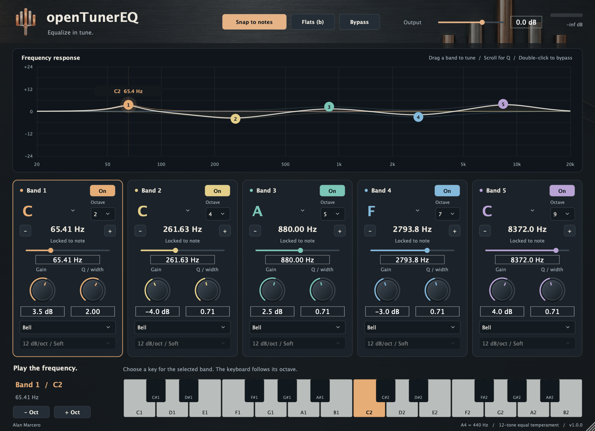

# openTunerEQ

[](https://github.com/alanmarcero/openTunerEQ/actions/workflows/build.yml)

**Equalize in tune.** A five-band parametric EQ that treats musical notes as first-class controls. Every band shows its note, octave, and exact frequency. Snap to a semitone, choose a note directly, or switch to free Hz tuning.



## Controls

- **Five bands:** individual enable, shape, frequency, gain and Q. All audio parameters support host automation and session recall.
- **Snap to notes:** on by default; applies to knobs, graph dragging and host automation. Uses 12-tone equal temperament from the **A4 reference** (400–480 Hz, default 440 Hz), so you can match material tuned to 432 or 442 Hz. Changing the reference moves every snapped band to the new grid. This is chromatic note snapping, not pitch detection or song-scale detection.
- **Note + octave selectors:** jump straight to a pitch. The − / + buttons step one semitone; the piano strip and octave buttons act on the selected band.
- **Sharp / flat spelling:** C# and Db represent the same pitch. The Flats button changes labels without changing the sound.
- **Free tuning:** disable Snap; each band still shows its nearest note and cents offset. The large Hz readout always shows the effective filter frequency.
- **Response graph:** drag numbered nodes for frequency and gain; scroll for Q; double-click a node to bypass that band. Colors link nodes to controls. The white line is the total response, including output trim.
- **Output / Bypass:** −24 to +12 dB output trim. Global bypass also bypasses output trim. Watch the output meter when boosting several bands.

| Shape | Gain | Q | Slope |
|---|---|---|---|
| Bell | ±24 dB | 0.1–18 | — |
| Low / high shelf | ±24 dB | Fixed, monotonic | — |
| High / low pass | — | 0.1–18 at 12 dB/oct | 12, 24, 48, 96 dB/oct |
| Notch | — | 0.1–18 | — |
| Band pass | — | 0.1–18 | — |

Unused controls are dimmed. For cuts, **12 dB/oct is soft; 96 dB/oct is steep**. These describe roll-off per octave, not a fixed attenuation amount or an ideal brick wall. Higher-order cuts use a Butterworth alignment with a −3 dB cutoff. Use shelf gain when you want a finite low/high cut such as −6 or −12 dB.

Frequency range is 20–20,000 Hz, limited below Nyquist at lower sample rates. Note snapping selects only pitches inside that range (E0 ≈ 20.60 Hz to D#10/Eb10 ≈ 19,912.13 Hz). Octave selectors support the entire range. Mono and stereo instances are supported. The EQ is minimum phase, with no lookahead or reported latency; parameter smoothing and short bypass/topology fades reduce switching clicks.

## Downloads and installation

Get build ZIPs from [GitHub Actions](https://github.com/alanmarcero/openTunerEQ/actions/workflows/build.yml) or tagged packages from [Releases](https://github.com/alanmarcero/openTunerEQ/releases).

- **macOS:** universal Apple Silicon + Intel VST3, AU, and standalone app. Copy `openTunerEQ.vst3` to `~/Library/Audio/Plug-Ins/VST3/` or `openTunerEQ.component` to `~/Library/Audio/Plug-Ins/Components/`, then rescan in your DAW. Requires macOS 11 or newer.
- **Windows:** x64 VST3 and standalone app. Copy the entire `openTunerEQ.vst3` directory to `C:\Program Files\Common Files\VST3\`, then rescan.

macOS packages are ad-hoc signed, not Apple-notarized. Gatekeeper or your DAW may require approval for downloaded binaries. Building locally is also supported. No commercial signing identity is required by CI.

## Build

Requires CMake 3.22+, a C++20 compiler, and network access to fetch JUCE 8.0.9. Xcode command-line tools on macOS; Visual Studio 2022 C++ tools on Windows.

```sh
cmake -S . -B build -DCMAKE_BUILD_TYPE=Release
cmake --build build --config Release --parallel 3
ctest --test-dir build -C Release --output-on-failure
```

Outputs are under `build/openTunerEQ_artefacts/Release/`. To build a universal macOS binary, add `-DCMAKE_OSX_ARCHITECTURES="arm64;x86_64" -DCMAKE_OSX_DEPLOYMENT_TARGET=11.0` when configuring.

The DSP tests can run without JUCE or GUI dependencies:

```sh
cmake -S . -B build-core -DOTE_BUILD_PLUGIN=OFF
cmake --build build-core
ctest --test-dir build-core --output-on-failure
```

## CI and source

Every push and pull request runs Linux DSP tests with address/undefined-behavior sanitizers, macOS universal and Windows x64 builds, audio/state/UI tests, and [pluginval](https://github.com/Tracktion/pluginval) at strictness level 5. Passing platform jobs upload ZIPs. Pushing a `v*` tag publishes a release after all jobs pass.

`Source/Core` contains the dependency-free DSP and tuning math. `Source/Plugin` contains the JUCE parameter, host, and UI integration. Bell, pass and notch sections use Vicanek's matched second-order design ("Matched Second Order Digital Filters", 2016), so they keep their analog shape up to Nyquist. Shelves follow the [W3C Audio EQ Cookbook](https://www.w3.org/TR/audio-eq-cookbook/). Build structure follows [openMaster](https://github.com/alanmarcero/openMaster) and [openEDMFilter](https://github.com/alanmarcero/openEDMFilter).

The graphite faceplate and metal tuning-fork emblem are generated raster assets embedded in the plugin. Prompts and provenance: [docs/assets.md](docs/assets.md). The screenshot above is rendered from the actual JUCE editor.

Copyright © 2026 Alan Marcero. Source is [AGPL-3.0](LICENSE); JUCE is used under its AGPL option. See [JUCE licensing](https://juce.com/legal/juce-8-licence/).
