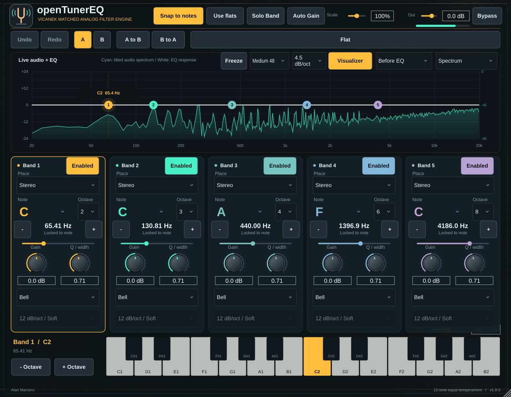

# openTunerEQ

A five-band equalizer with note-aware controls and a live spectrum display.

[Download the latest release](https://github.com/alanmarcero/openTunerEQ/releases/latest) · [Install with OpenVST Manager](https://github.com/alanmarcero/alan-m-OpenVSTManager/releases/latest)

## Beta

All of these plugins are in beta. The macOS and Linux builds are not up to date, so the Windows build is the one to use for now. A plugin can change dramatically from one release to the next, but the goal is for each one to keep getting better.

The tuning fork in the header pulses on host quarter notes and holds when the host stops. In standalone mode it follows a 120 BPM sample clock.

## Equalizer

Each band has its own enable switch, frequency, gain, Q, filter shape, and channel placement. Choose Bell, Low shelf, High shelf, High pass, Low pass, Notch, or Band pass. Frequency covers 20 Hz to 20 kHz, with a lower maximum at low sample rates. Gain covers ±24 dB, and Q covers 0.1 to 18. High-pass and low-pass slopes are 12, 24, 48, or 96 dB per octave.

Place a band on Stereo, Left, Right, Mid, or Side. Stereo is the default, so older sessions sound the same. Left and Right leave the other channel alone. Mid and Side use a level-matched encode: a centered signal is unchanged when the band is flat, a Side high-pass keeps bass in the middle, and a Mid boost stays out of the sides. On the graph, those curves are dashed and marked L, R, M, or S. The white sum is the stereo bands only.

Turn on **Snap to notes** to tune bands to semitones, including host automation. Set the A4 reference from 400 to 480 Hz to match your tuning. Choose a note and octave, or step one semitone at a time. Display notes as sharps or flats. Turn snapping off for free tuning; the display still shows the nearest note and cents.

Drag a band on the graph to change frequency and gain, and hold Shift for fine moves. Scroll over a band to change its Q. Double-click a band to bypass it. Hover to read frequency and note. With the analyzer on, the graph also shows audio level. Alt/Option-click to move the selected band to that frequency; turn snapping off for exact placement.

## Analyzer

Choose Spectrum, Bars, or Spectrogram. View audio before or after the EQ, freeze the display, set Slow, Medium, or Fast falloff, and tilt the spectrum by 0, 3, 4.5, or 6 dB per octave. The editor saves these display settings with your session.

Output trim ranges from −24 to +12 dB. Global bypass includes output trim. The EQ supports mono and stereo and adds no latency.

The factory bank has eleven starting points: Flat, Low-end cleanup, Kick punch, Vocal presence, Hat air, Off-beat notch, Side high-pass, Mid focus, Warm lows, Harshness tame, and Side air. They appear in the editor and in the DAW program list. Flat is the default.

Undo and redo sit in the editor bar. Cmd+Z and Shift+Cmd+Z do the same on Mac; Ctrl+Z and Shift+Ctrl+Z do it on Windows and Linux. A drag that moves frequency and gain is one undo step. A and B are two full copies of the plugin state. Click A or B to switch, and use A to B or B to A to copy one onto the other. Each slot keeps its own undo history, and a copy clears the history of the slot it replaces. Save, rename, and delete your own presets in Documents/Alan Marcero/openTunerEQ/Presets. Search the list, and mark favorites. Factory presets stay read-only.

## Formats

- **macOS 11 or newer:** Universal VST3, Audio Unit (AU), and standalone app.
- **Windows x64:** VST3 and standalone app.

Use [OpenVST Manager](https://github.com/alanmarcero/alan-m-OpenVSTManager/releases/latest) or download a package from the [latest release](https://github.com/alanmarcero/openTunerEQ/releases/latest).

## License

MIT. See [LICENSE](LICENSE) for terms.
