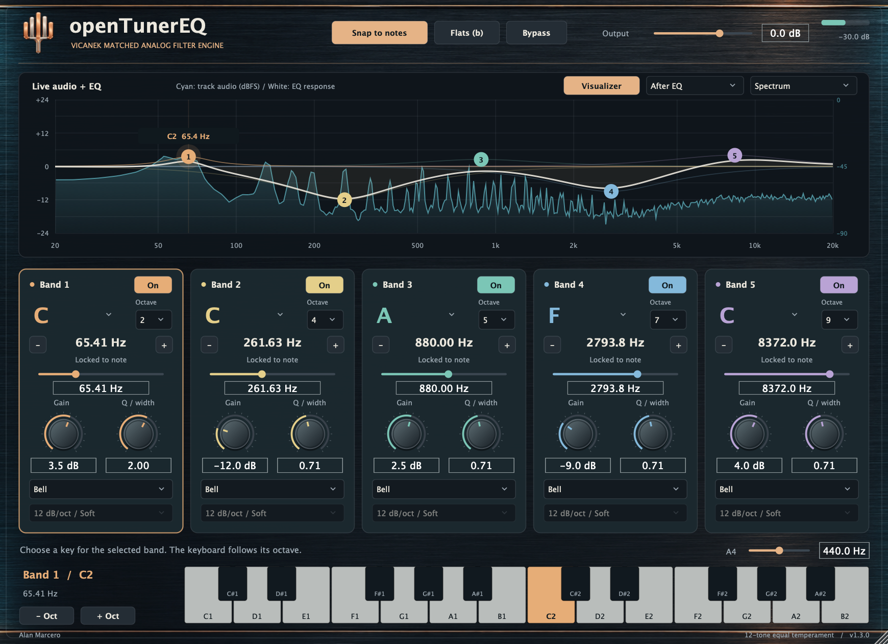

# Native UI screenshots

Before EQ: cyan shows the incoming track’s audio spectrum, and white shows the EQ response.

After EQ: the same input signal and EQ settings, with cyan now showing the processed output.

These v1.2.1 screenshots were captured on macOS on 2026-11-03 from the actual JUCE editor created by the processor/UI test harness. The plugin processes a deterministic stereo musical test signal at 48 kHz: harmonic notes, a pulsed bass drum and noise-based percussion. The EQ includes a 12 dB cut around 262 Hz and a 9 dB cut around 2.8 kHz, making the change in the audio spectrum visible when switching source. Text, curves, controls and spectrum data are rendered by the plugin.

Run `build/plugin_tests assets/native-ui.png` after a Release build to reproduce all four 1740 × 1260 captures. The screenshot path processes audio and refreshes the graph at approximately its normal 24 Hz cadence. These are native component snapshots with synthesized audio, not screenshots from a DAW or a downloaded release archive.

