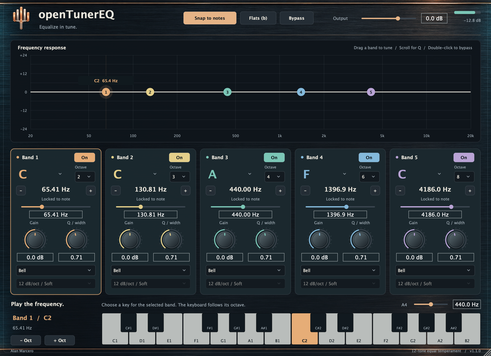

# Native UI screenshot

`assets/native-ui.png` was captured on macOS on 2026-10-27 from the actual **v1.1.0 VST3 editor**, loaded in a JUCE 8.0.9 host. It shows the plugin's default state while processing a stereo test signal at 48 kHz with a 120 BPM host transport. The host renders the native AppKit view into a PNG at the display's backing resolution (2320 × 1680). Controls, labels, meters and version text come from the running plugin.

- [Release v1.1.0](https://github.com/alanmarcero/openTunerEQ/releases/tag/v1.1.0)
- Source commit: [`175dab8`](https://github.com/alanmarcero/openTunerEQ/commit/175dab8739fcd1bb2739ffe77f352de724c858dd)
- Release asset: `openTunerEQ-macOS-universal.zip`
- Archive SHA-256, verified before capture: `d3f6cf76ed992a7a03331714ed646eb9d92093a55e5d83bbab4e1a24e5c16ce1`
- Screenshot SHA-256: `2d8ff91960e5ffe6670b10c189b1d7e7d9963cd205ac8bfdf01ae4999eff50ea`
