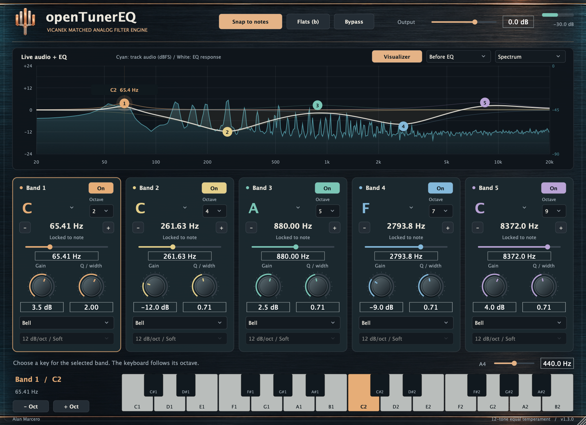
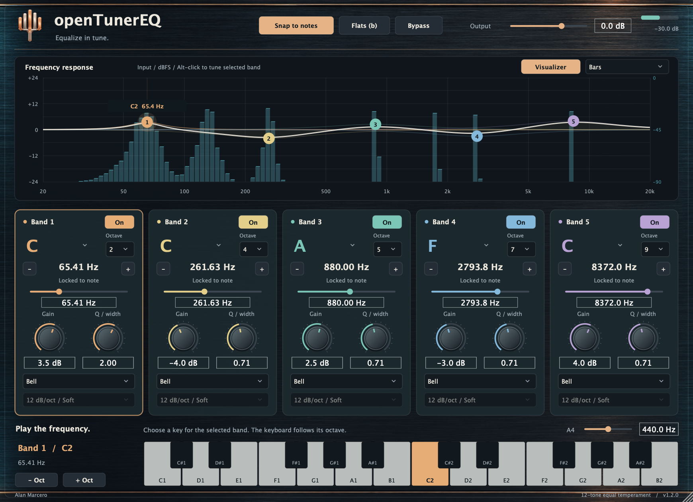
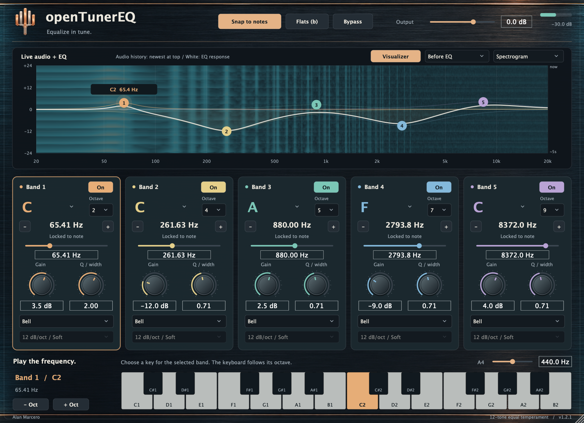

# Native UI screenshots

These v1.2.0 screenshots were captured on macOS on 2026-11-03 from the actual JUCE editor created by the processor/UI test harness. The plugin processes a stereo multitone signal at 48 kHz, with peaks at approximately 65, 131, 262, 880, 1760, 2794 and 8372 Hz. The EQ bands have representative boosts and cuts. Text, curves, controls and spectrum data are rendered by the plugin; no visualization is painted into the faceplate image.

Run `build/plugin_tests assets/native-ui.png` after a Release build to reproduce all three 1740 × 1260 captures. The screenshot path processes audio and refreshes the graph at approximately its normal 24 Hz cadence. These are native component snapshots, not screenshots from a DAW or a downloaded release archive.

