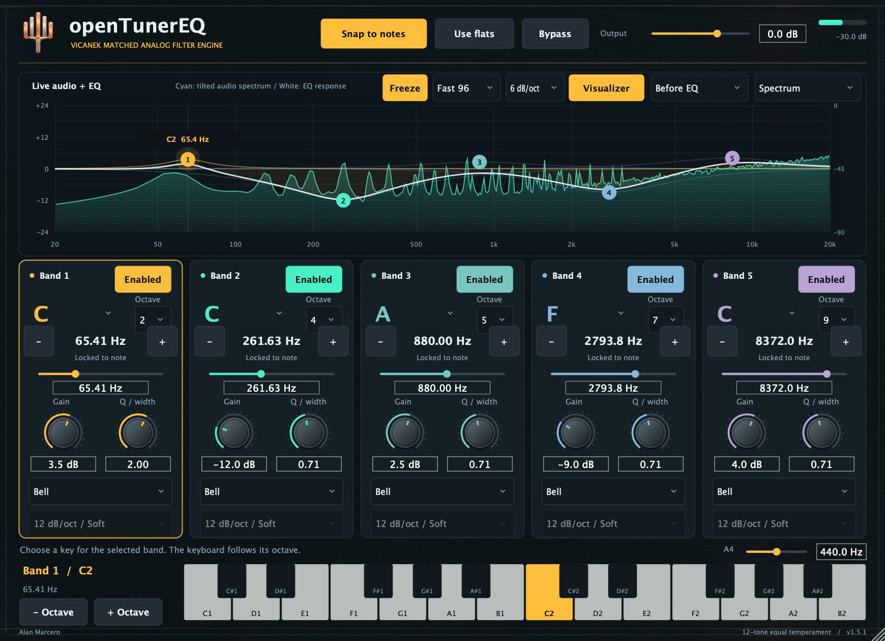
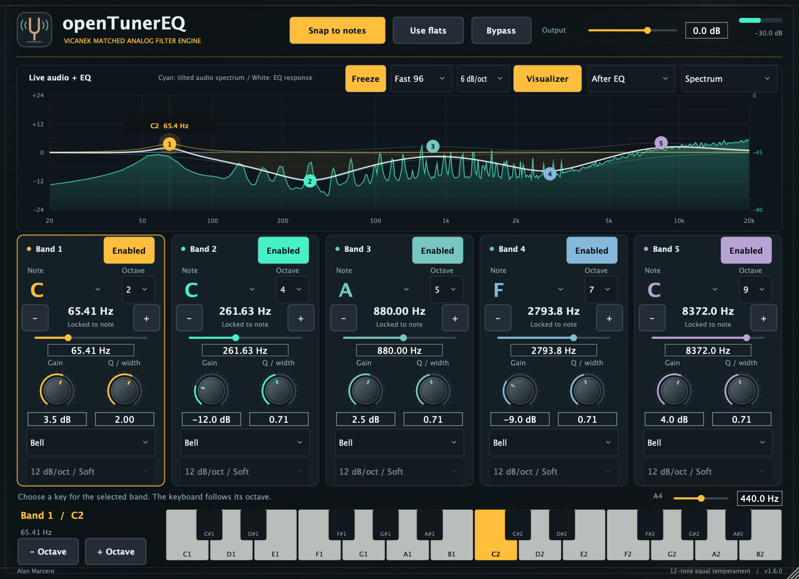
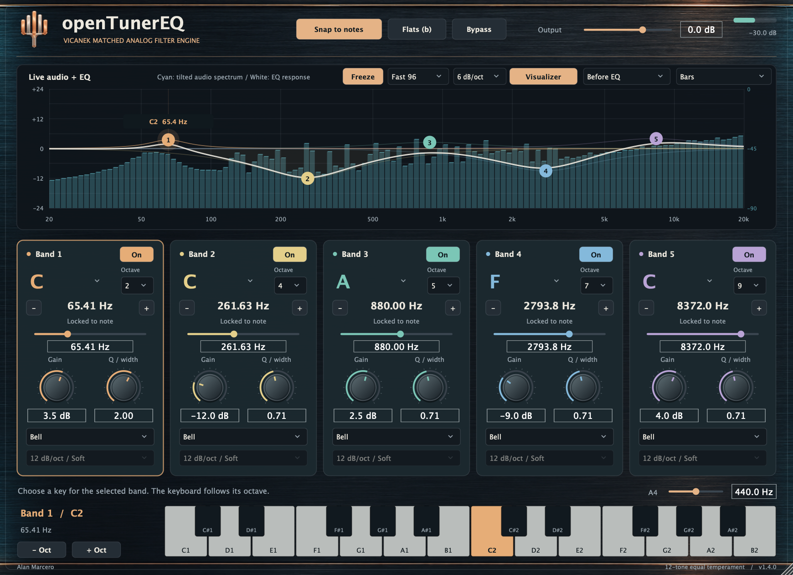
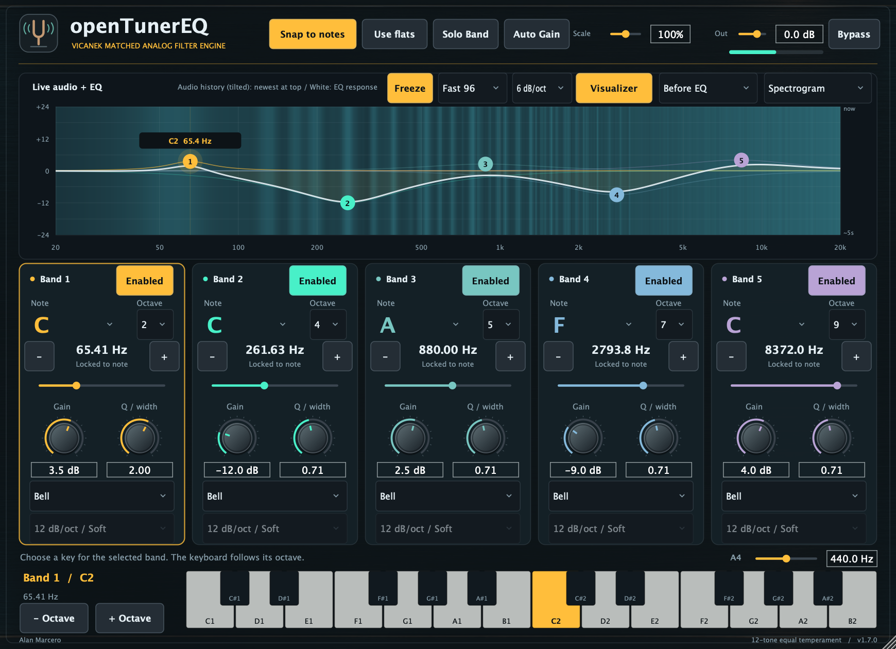

# Native UI screenshots

Before EQ: mint shows the incoming track’s audio spectrum, and white shows the EQ response.



After EQ: the same input signal and EQ settings, with mint now showing the processed output.



These screenshots were captured on macOS from the current Release build's actual JUCE editor created by the processor/UI test harness. The plugin processes a deterministic stereo musical test signal at 48 kHz: harmonic notes, a pulsed bass drum and noise-based percussion. The EQ includes a 12 dB cut around 262 Hz and a 9 dB cut around 2.8 kHz, making the change in the audio spectrum visible when switching source. The main capture shows Freeze enabled with Fast release and 6 dB/oct tilt so the three analyzer additions can be inspected. Text, curves, controls and spectrum data are rendered by the plugin.

Run `build/plugin_tests assets/native-ui.png` after a Release build to reproduce all four 1740 × 1260 captures. The screenshot path processes audio and refreshes the graph at approximately its normal 24 Hz cadence. These are native component snapshots with synthesized audio, not screenshots from a DAW or a downloaded release archive.






## OpenVST Manager preview

OpenVST Manager shows `docs/screenshots/preview.png` from `main` (see `screenshotPath` in its catalog), and the GitHub release body and README hero point at the same file. This is the single image to keep current. Refresh it with the main editor capture whenever the UI changes, and commit it before tagging a release:

```sh
mkdir -p build/shots && build/plugin_tests build/shots/native-ui.png
cp build/shots/native-ui.png docs/screenshots/preview.png
```
